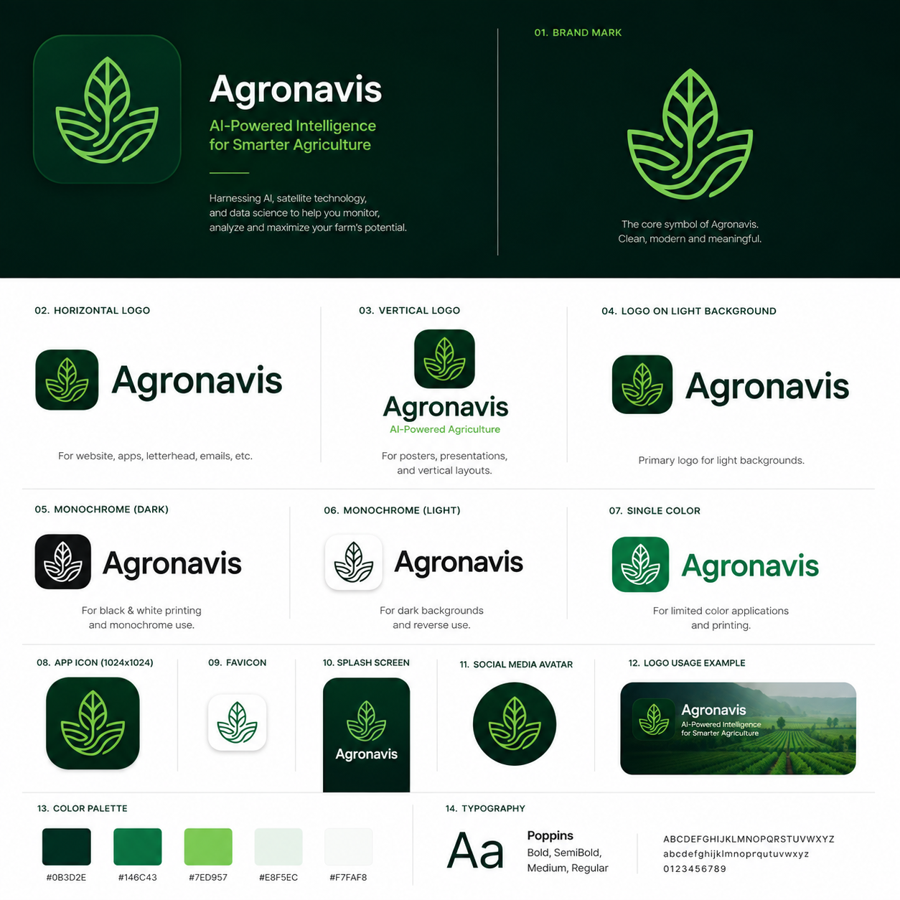

<div align="center">



# Agronavis

### Every field in India, advised.

Soil, weather, crops, disease and the day's market price — for one mapped field,
with an assistant that answers in the farmer's own language.

[](https://play.google.com/store/apps/details?id=com.agronavis.app)
[](CHANGELOG.md)

**Live on Google Play** · Android · [agronavis.in](https://agronavis.in)

</div>

> [!IMPORTANT]
> **This is a production repository.** `main` is what farmers are running.
> Every change reaches it through a reviewed pull request with CI green — see
> **[CONTRIBUTING.md](CONTRIBUTING.md)**. Releases are cut as described in
> **[docs/RELEASING.md](docs/RELEASING.md)**.

---

## The problem

An Indian farmer makes four decisions every season. Each one costs money when it
goes wrong, and each one is usually made without data.

| The question                   | How it is answered today                                          |
| ------------------------------ | ----------------------------------------------------------------- |
| What is in my soil?            | The government measured it. The farmer has never seen the number. |
| When do I water?               | Guesswork, or waiting and hoping the rain arrives in time.        |
| What is this spot on the leaf? | Ask a neighbour, or buy whatever the shop suggests.               |
| What is my crop worth?         | Make the trip to the mandi and find out on arrival.               |

Every one of these already has an answer sitting in a public government dataset.
None of them reach the person standing in the field.

**Agronavis answers all four, for one field, from the moment the farmer draws it
on a map.**

---

## How it works

**It starts with the boundary.** The farmer traces their field on satellite
imagery, once. Everything afterwards is about that field — not a district
average, not a village estimate, not the nearest weather station. A farm can
hold many fields, and plots hundreds of kilometres apart read differently.

|             | What the farmer gets                                                                                                          |
| ----------- | ----------------------------------------------------------------------------------------------------------------------------- |
| **Soil**    | Nitrogen, phosphorus, potassium and nine more nutrients, from the government's own laboratory testing of their district.      |
| **Weather** | Live conditions over the field, and the one answer that matters — how much water the crop is losing, and whether to irrigate. |
| **Crops**   | A season laid out as dated tasks, chosen from the crops the national scheme actually lists for their state.                   |
| **Scanner** | Photograph an affected leaf; an answer in about a second, with the next two most likely conditions beside it.                 |
| **Market**  | A representative price for their state with its range, and the mandis that reported it.                                       |
| **Sahayak** | An assistant that already knows their fields, soil and weather. They can speak to it, and it speaks back.                     |

---

## What a farmer gets

Map one field, and the app reads what is above and below it.

| | |
| --- | --- |
| **Soil** | Twelve nutrients for your district, from the Government of India's Soil Health Card, with the number of samples behind each so you can judge it |
| **Water** | How much the soil holds, measured by satellite rather than worked out from rainfall, beside the irrigation the water balance calls for |
| **Crop health** | Sentinel-2 vigour at 10 m, measured every clear pass, leading with the change since last time |
| **Disease** | A reading from a photograph of a leaf, with a confidence figure and the honesty to say when it does not know |
| **Smoke** | Stubble fires within 150 km, and whether the wind is bringing their smoke to you |
| **Prices** | Mandi rates from Agmarknet for the commodities you grow |
| **Sahayak** | A farming assistant that runs on the phone — your questions never leave it, and it quotes real mandi rates rather than inventing one |
| **Neighbours** | A feed of farmers near you, with reporting and a block that works both ways |
| **Alerts** | Only the kinds you asked for, and muting one still records it |

## What is loaded today

These are counts from the live production database, not projections.

|            |                                        |
| ---------- | -------------------------------------- |
| **712**    | districts of soil data                 |
| **32**     | states and territories                 |
| **11,332** | market price records                   |
| **1,491**  | mandis reporting prices                |
| **4,172**  | mandis in the directory                |
| **1,812**  | crops in the scheme catalogue          |
| **86**     | crop conditions the scanner recognises |
| **8**      | languages Sahayak answers in           |

---

## Every number has an owner

| What the farmer sees | Where it comes from              | Who owns it         |
| -------------------- | -------------------------------- | ------------------- |
| Soil nutrients       | Soil Health Card survey          | Government of India |
| Rain and sunlight    | POWER satellite record           | NASA                |
| Water requirement    | Penman–Monteith method           | United Nations FAO  |
| Mandi prices         | Agmarknet reporting network      | Government of India |
| Crop lists           | Fertiliser recommendation scheme | Government of India |
| Disease reading      | Our own trained model            | Agronavis           |

Five of the six come from public institutions. We are not asking a farmer to
trust our opinion — we are delivering records that already exist, to the field
they belong to.

---

## Why this one gets used

A farmer forgives an app that says _"I am not sure"_. They never open one again
after it was confidently wrong. So Agronavis is built to admit what it does not
know:

- **The scanner refuses photographs that are not crops**, instead of forcing
  every image into one of its 86 labels the way these models normally do.
- **A weak reading is labelled a hint, never a diagnosis**, and the farmer is
  always asked to confirm against the reference library before spraying.
- **Soil readings show their evidence** — the full High/Medium/Low split and the
  number of samples behind it. A thinly tested district is marked as one.
- **When district data is missing**, the reading widens to the state and says so,
  rather than inventing a number.
- **The irrigation advice shows its working**, as a full daily record anyone can
  check.

---

## What comes next

- **The screens in more than English.** Sahayak already answers in eight
  languages; the screens themselves are English, and the app says so plainly
  rather than claiming otherwise.
- **Push notifications actually reaching handsets.** Alerts are written and
  shown in the app, but no FCM project exists yet, so no phone is woken.
- **Over-the-air updates.** `expo-updates` is not installed, so every fix
  needs a store round trip.
- Fertiliser and pesticide quantities worked out for the field's actual acreage
- A second model dedicated to deciding whether a photograph shows a crop at all
- Dated task timelines extended across the full crop catalogue

---

## References

| Used for                | Source                                                                                             |
| ----------------------- | -------------------------------------------------------------------------------------------------- |
| Water requirement       | Allen, Pereira, Raes & Smith (1998). _Crop Evapotranspiration._ FAO Irrigation & Drainage Paper 56 |
| Sunlight and rainfall   | NASA POWER — Prediction Of Worldwide Energy Resources, NASA Langley Research Center                |
| Soil nutrients          | Soil Health Card scheme, Department of Agriculture & Farmers Welfare, Government of India          |
| Market prices           | Agmarknet, Directorate of Marketing & Inspection, Government of India                              |
| Scanner architecture    | He, Zhang, Ren & Sun (2016). _Deep Residual Learning for Image Recognition._ CVPR                  |
| Crop detection in frame | Woebbecke, Meyer, Von Bargen & Mortensen (1995). _Color Indices for Weed Identification._ ASAE     |

---

## For developers

**Start with [CONTRIBUTING.md](CONTRIBUTING.md)** — `main` is production, and
nothing lands on it except through a reviewed pull request. How a release is
cut is in **[docs/RELEASING.md](docs/RELEASING.md)**.

What the app does for a farmer, feature by feature with the release each
arrived in, is in **[docs/FEATURES.md](docs/FEATURES.md)**.

Legal documents are generated from `features/legal/documents.ts` by
`npm run legal`, so the app, the website and the Play Store listing cannot
drift apart: **[TERMS.md](TERMS.md)**, **[PRIVACY.md](PRIVACY.md)**,
**[SECURITY.md](SECURITY.md)**.

Setup, architecture, scripts and deployment are in
**[docs/DEVELOPMENT.md](docs/DEVELOPMENT.md)**. How every model works, where
the data comes from and the limits of each are in
**[docs/architecture/](docs/architecture/README.md)**. Step-by-step builds of
individual features, written so one could be rebuilt from nothing, are in
**[docs/guides/](docs/guides/BUILDING-FIELD-MONITORING.md)**.

```bash
git clone https://github.com/jpdevhub/Agronavis-App.git && cd Agronavis-App
cp .env.example .env
npm install --legacy-peer-deps
npm run dev
```
